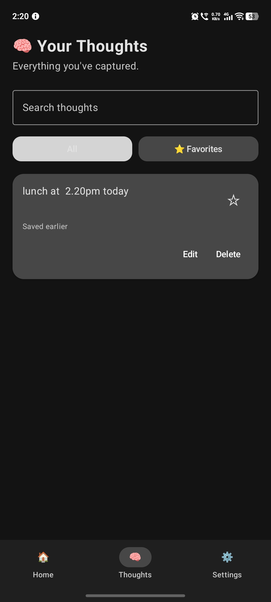
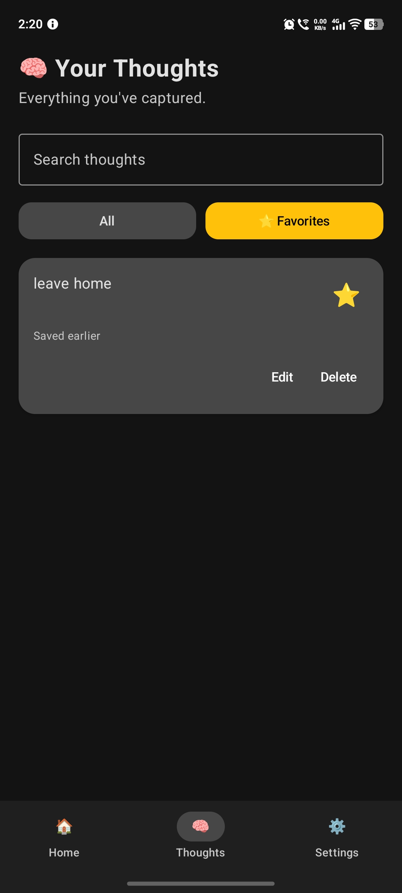

# BrainDump

<p align="center"><strong>A private space to capture thoughts, organize ideas, and remember what matters.</strong></p>

<p align="center">
  
  
  
  
</p>

BrainDump is an Android thought-management app built around a simple idea: capture a thought quickly, then organize it when you're ready. Save ideas locally, find them later, mark important thoughts as favorites, and create reminders.

> **Project status:** Work in progress. AI-powered organization and other roadmap items are future plans, not currently shipped functionality.

## Screenshots

<p align="center">
  
  
  
</p>

## Current Features

- Quick thought capture
- Local persistence for saved thoughts
- Search and filtering
- Favorites for important thoughts
- Reminders and notifications
- Native Android UI using Jetpack Compose
- Light and dark appearances

## Technology

| Technology | Role |
|---|---|
| Kotlin | Main application language |
| Jetpack Compose | Android UI |
| Room | Local database |
| Android SDK | Platform APIs |
| Kotlin Coroutines | Asynchronous work |
| AlarmManager | Reminder scheduling |
| Material 3 | UI components |

## Project Direction

The longer-term goal is to make BrainDump a thoughtful, privacy-conscious personal idea assistant. Planned ideas include AI-assisted summaries and categories, semantic search, natural-language reminder creation, and privacy-aware offline capabilities. These are exploratory roadmap items, not currently available features.

## Getting Started

1. Clone the repository:
   ```bash
   git clone https://github.com/Aditya090908/BrainDump.git
   ```
2. Open the cloned `BrainDump` folder in Android Studio.
3. Allow Gradle to sync and download dependencies.
4. Select an Android emulator or connect a device with USB debugging enabled.
5. Run the app configuration.

## Roadmap

- [x] Android application foundation
- [x] Thought capture and local persistence
- [x] Search and favorites
- [x] Reminder and notification flow
- [x] Light and dark appearance
- [ ] Verify and document all feature behavior
- [ ] Add a reproducible release build
- [ ] Publish an installable APK or GitHub release
- [ ] Explore privacy-first AI features

## Author

**Aditya Kumar** · [@Aditya090908](https://github.com/Aditya090908)
