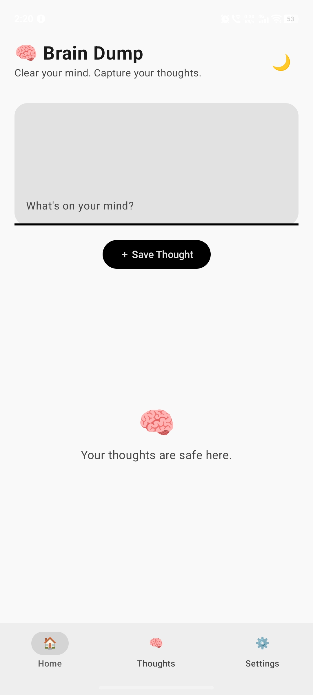
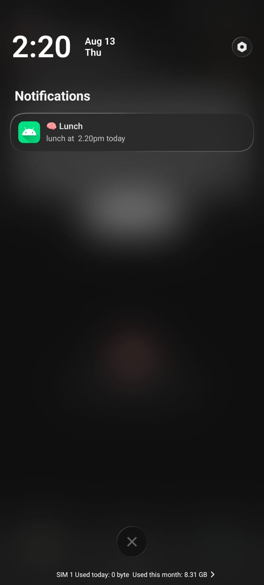

# BrainDump

<p align="center">
  <strong>A private space to capture thoughts, organize ideas, and remember what matters.</strong>
</p>

<p align="center">
  
  
  
  
</p>

BrainDump is an Android thought-management app built around one simple idea: capture a thought quickly, then organize it when you're ready. Save ideas locally, find them later, mark important thoughts as favorites, and create reminders.

> **Project status:** Work in progress. The repository contains an Android app foundation and the features documented below. AI-powered organization and other roadmap items are future plans, not currently shipped functionality.

## Screenshots

<p align="center">
  
  
  
</p>
<p align="center">
  
  
  
</p>

## Current features

- **Quick capture** — save thoughts without a complicated workflow.
- **Local persistence** — keep saved thoughts on the device.
- **Search and filtering** — find thoughts when you need them.
- **Favorites** — keep important thoughts easy to reach.
- **Reminders and notifications** — schedule a prompt to revisit a thought.
- **Compose interface** — native Android UI built with Jetpack Compose.
- **Theme support** — includes dark and light appearances.

Feature availability and behavior may change as development continues.

## Built with

| Technology | Role |
|---|---|
| Kotlin | Main application language |
| Jetpack Compose | Android UI |
| Room | Local database |
| Android SDK | Platform APIs |
| Kotlin Coroutines | Asynchronous work |
| AlarmManager | Reminder scheduling |
| Material 3 | UI components |

## Project direction

The longer-term goal is to make BrainDump a thoughtful, privacy-conscious personal idea assistant.

Planned ideas include:
- On-device or privacy-aware AI assistance
- Automatic thought summaries and categories
- Semantic search
- Natural-language reminder creation
- Offline-capable AI features

These are exploratory roadmap items and should not be considered available features yet.

## Getting started

### Requirements

- Android Studio
- Android SDK compatible with the project configuration
- JDK version required by the project's Gradle configuration

### Open the project

1. Clone this repository:
   ```bash
   git clone https://github.com/Aditya090908/BrainDump.git
   ```
2. Open the cloned `BrainDump` folder in Android Studio.
3. Allow Gradle to sync and download the required dependencies.
4. Select an Android emulator or connect a device with USB debugging enabled.
5. Run the `app` configuration.

> The exact Android and JDK requirements should be confirmed against the Gradle and app configuration before a release build is published.

## Repository structure

The project is an Android Gradle application. The `app/` directory contains the application module, while the root contains Gradle wrapper and project configuration files.

## Roadmap

- [x] Android application foundation
- [x] Thought capture and local persistence
- [x] Search and favorites
- [x] Reminder and notification flow
- [x] Light and dark appearance
- [ ] Verify and document all feature behavior
- [ ] Add a reproducible release build
- [ ] Publish an installable APK or GitHub release
- [ ] Explore privacy-first AI features

## Author

**Aditya Kumar** · [@Aditya090908](https://github.com/Aditya090908)

---

<p align="center">
  <sub>Built to make capturing a thought feel effortless.</sub>
</p>
